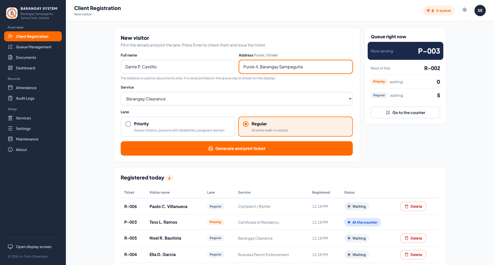
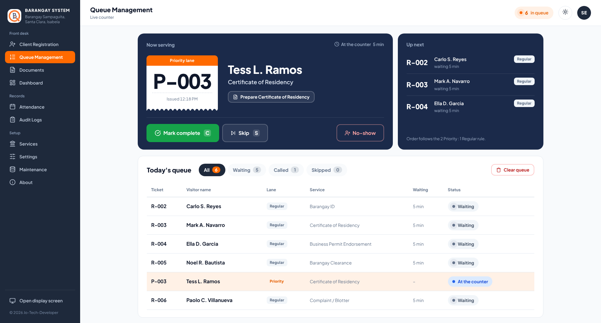
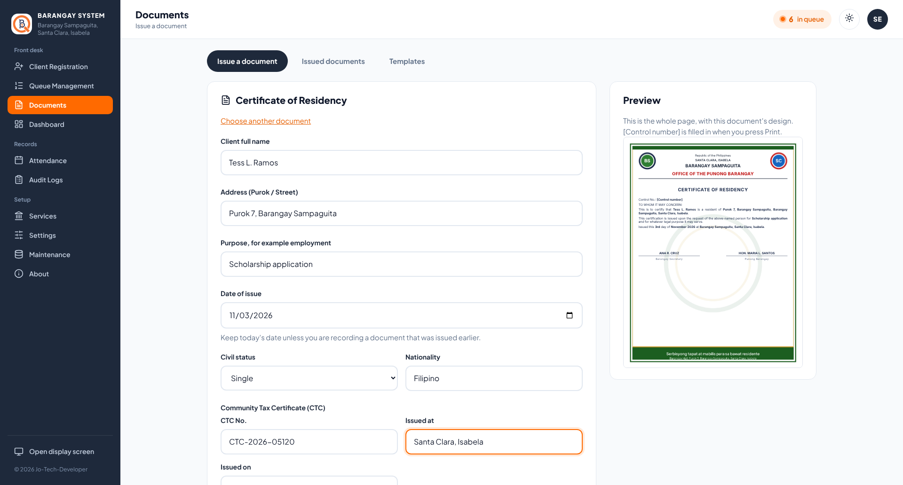
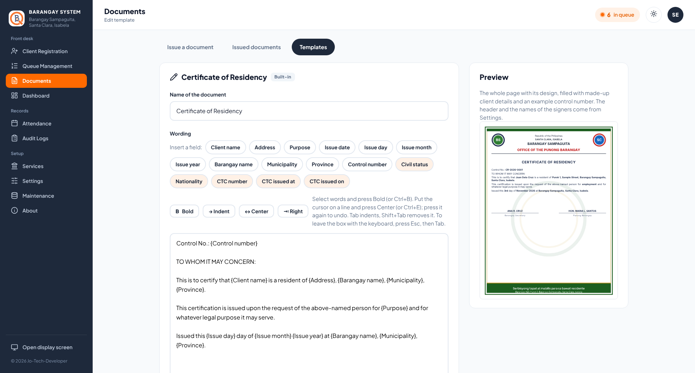
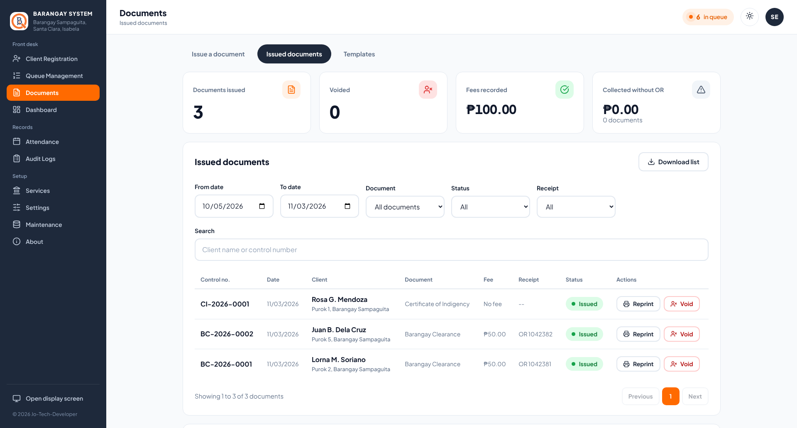
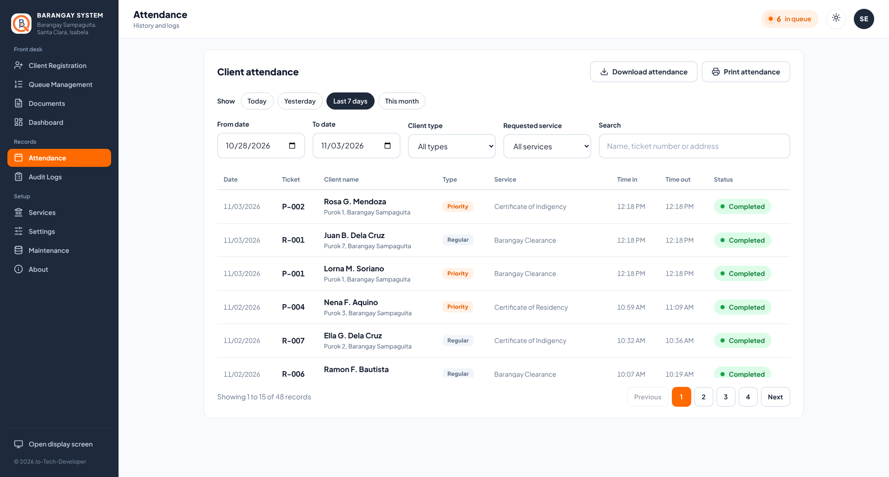
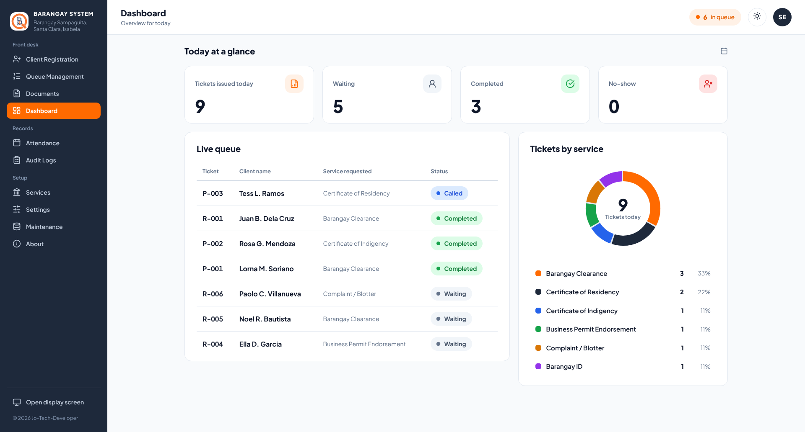
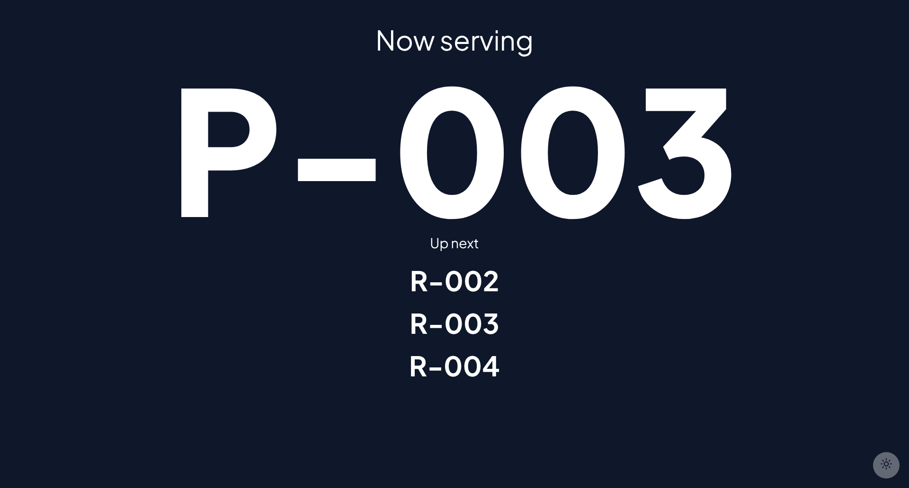
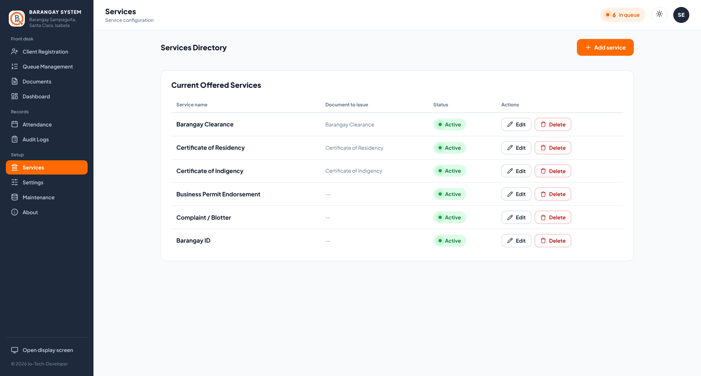
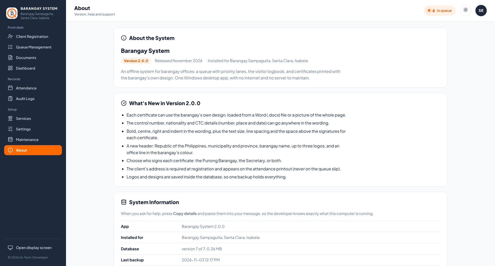

# Barangay System

**An offline system for barangay offices: a fair queue with priority lanes, the visitor logbook, and certificates printed with the barangay's own design. One Windows desktop app, with no internet and no server to maintain.**


The secretary registers each walk-in visitor, prints a numbered slip, and calls visitors in order, with senior citizens, persons with disabilities and pregnant women served first. Every visit is saved in the attendance record, and the certificates the visitor came for are prepared, numbered and printed from the same app. Any barangay can set it up with its own name, logos, signatories and certificate designs.

| | |
|:--:|:--:|
| <br>**Register a visitor and print a ticket** | <br>**Call, complete, skip or mark no-show** |
| <br>**Prepare a certificate for the visitor being served** | <br>**Edit the wording and design of each certificate** |
| <br>**Issued documents: reprint, void, OR numbers** | <br>**Searchable attendance history** |
| <br>**Today at a glance** | <br>**Now Serving display for a second screen** |
| <br>**Services and the certificate each one prepares** | <br>**Version, system details and help** |

Screenshots use a made-up barangay and made-up residents.

**Current version:** 2.0.0 (November 2026)

## Why it matters

Walk-in service at a small office often runs on shouted names, a paper logbook and certificates retyped in Word for every client. Priority visitors wait behind everyone else, nobody can say how many people were served, and a typo means printing the certificate again.

This system replaces that with:

- **Fair, visible order.** Every visitor gets a numbered ticket, and the queue is called in a set pattern.
- **Priority that actually works.** Priority and Regular lanes are served in a 2:1 pattern, so Regular visitors still move.
- **Records without paper.** Every completed or missed visit is stored with the time in and out, ready for reports.
- **Certificates in minutes.** The wording is saved once; staff fill in the client's details and print a numbered certificate.
- **No dependence on connectivity.** It runs entirely on one PC, so a poor connection can't stop the office.
- **Resident data stays in the office.** Nothing is sent over the internet.

## Features

**Queueing**
- Priority and Regular lanes, with tickets numbered per lane (`P-001`, `R-014`) and reset each day
- Call Next with a spoken announcement of the ticket number, from bundled audio clips, so no internet or speech engine is needed
- Complete, Skip (and Recall later), and No-Show, with a clear end-of-day **Clear queue**
- A **Now Serving** display screen that opens in its own window, for a second monitor or TV
- Live panels that update instantly, and protection against double clicks and duplicate tickets

**Documents and certificates**
- Built-in Certificate of Residency, Barangay Clearance and Certificate of Indigency, plus a blank document to start your own
- Templates tab: edit the wording with fields such as `{Client name}`, `{Purpose}` and `{Control number}`, with bold, centre, right and indent, and a live preview
- Per certificate: its own design from a Word (.docx) file or a whole-page picture, text size, line spacing and the space above the signatures
- Optional details per certificate: age, civil status, years of residence, nationality, CTC number, place and date, OR number and fee, and a validity period
- Signed by the Punong Barangay, the Secretary, or both
- Control numbers per certificate type and year, in the style the barangay chooses (for example `BC-2026-0001`)
- A **Prepare** button (for example *Prepare Barangay Clearance*) on the Now Serving card, for services linked to a certificate
- Issued documents are kept exactly as printed: reprint, void and reissue, add an OR number later, and download the history as a list

**Records**
- Attendance history with date range, client type, service and name, ticket or address search
- Print view (with each client's address) and CSV export
- Dashboard with today's totals and service volume

**Setup and administration**
- First-run wizard: barangay name, municipality and province, header lines and office colour, up to three logos, signatories and a test page
- Settings page to change any of these later
- Single administrator account with first-time setup, password change, and recovery key reset
- Service directory (add, edit, remove) and an **audit log** of every action
- Automatic daily backups (one for each of the last 14 days used), a second backup folder such as a USB drive, manual backup, and purge of old attendance records
- Light, dark and Same as Windows appearance
- An **About** page with the version, system details for support (with a **Copy details** button), quick help, the terms of use and the open-source licenses

**Hardware**
- Prints queue slips on ESC/POS thermal receipt printers (58 mm or 80 mm) installed in Windows, with a test slip and reprint
- Prints certificates on any Windows printer, on Letter, A4 or long bond paper

## How it works

1. **Register.** The secretary enters the visitor's name, address, service and lane. A ticket is issued and a slip is printed (the slip never shows the address).
2. **Call.** Pressing *Call next* announces the ticket number aloud and shows it on the display screen.
3. **Serve.** If the visitor's service is linked to a certificate, its *Prepare* button opens the issue form with their name already filled in; the certificate is printed with the next control number.
4. **Finish.** The secretary marks the visit *complete*, or *skip* if the visitor stepped away, or *no-show* if they never came. Skipped visitors can be recalled.
5. **Close the day.** *Clear queue* records anyone still unserved as no-show. A backup is taken automatically each day.
6. **Report.** The Attendance and Documents pages filter the history and print or export it.

## Getting started

### Install

1. Run `Barangay_System_Setup.exe` and accept the terms. The installer is not code-signed, so Windows may show "Windows protected your PC": choose **More info**, then **Run anyway**.
2. Open the app and create the administrator account.
3. **Write down the recovery key** shown at the end of setup. It appears only once and is the way back in if the password is lost.
4. Follow the first-run wizard to enter the barangay's details, logos and signatories, and print the test page.

**Requirements:** 64-bit Windows 10 or 11, and the Microsoft Edge WebView2 Runtime, which is already on most up-to-date systems. A thermal printer is optional.

### Set up the receipt printer

1. Install the printer in Windows as usual.
2. Open **Maintenance → Receipt printer**, choose the printer and the paper width, and press **Save printer**.
3. Press **Print test slip** to check that the text fits on one line.

### Set up the certificates

1. Open **Documents → Templates** and choose a certificate.
2. Check the wording, tick the details it needs, and choose who signs it.
3. Under **Design**, load the barangay's blank certificate made in Word or WPS (.docx), or a picture of the whole page.
4. Adjust the text size and spacing until the preview fits on one page, then save.

### Run from source

The app is built for Windows and Python 3.13.

```
python -m venv .venv
.venv\Scripts\activate
pip install -r requirements-dev.txt
python run_app.py
```

For development without a printer, set the environment variable `BQS_DUMMY_PRINTER=1`: each slip is then written to `last_ticket_printed.txt` instead of being printed. When run from source, the database and other data are kept in the project folder.

### Build the installer

1. Run `build.bat` with the virtual environment active. It writes the open-source license list (`make_notices.py`), then builds the app into `dist\Barangay_System` with PyInstaller.
2. Open `installer.iss` in Inno Setup and press **Compile**. The installer is written to `installer_output\Barangay_System_Setup.exe`.

Keep `APP_VERSION` in `main.py` and `MyAppVersion` in `installer.iss` the same.

## Built with

| Area | Technology |
|---|---|
| Languages | Python 3.13, JavaScript, HTML5, CSS3 |
| Backend | FastAPI, Uvicorn |
| Database | SQLite through SQLAlchemy, with self-applying schema upgrades and a safety copy before each one |
| Frontend | Jinja2 templates, plain CSS, vanilla JavaScript, Plus Jakarta Sans |
| Live updates and audio | FastAPI WebSockets, pre-recorded MP3 announcements |
| Pictures and designs | Pillow for logos and design pictures; Word (.docx) designs read with Python's standard library, without Word |
| Security | Session cookies (Starlette), bcrypt password hashing |
| Printing | python-escpos and pywin32 (ESC/POS thermal printers); certificates through the Windows print dialog |
| Desktop and packaging | pywebview, PyInstaller, Inno Setup |

## Your data

All data lives on the office computer in `%LOCALAPPDATA%\Barangay_Queuing_Attendance_Management`: the database (with the logos and certificate designs inside it), backups, the log file and the app's settings. Uninstalling the program does not delete it. Passwords and the recovery key are stored only as bcrypt hashes.

When a new version upgrades the database, it first saves a copy next to it (for example `barangay_system.db.before_v7.bak`). Documents already issued are never rewritten, so their reprints look the same as the original.

The database runs in SQLite's WAL mode, so the daily backup is made in the background while people keep working. While the app is open you will also see `barangay_system.db-wal` and `barangay_system.db-shm`: they hold the newest changes and are merged into `barangay_system.db` when the app closes. To restore a backup by hand, close the app, delete those two files if they are still there, then copy the backup in and rename it `barangay_system.db`.

## Scope

Built for **one office and one queue** on one shared Windows PC. Each person signs in with their own staff account, and the administrator decides what each role may do. Each barangay sets its own name, logos, signatories and certificate designs. It has no multi-counter mode, no network mode for several PCs, and no online services.

## Project layout

```
main.py            routes, queue logic, printing, audit log, backups, About page
database.py        models and database upgrades
branding.py        barangay profile, logos and header settings
documents.py       issuing documents: form values, designs, spacing, saved copies
doc_templates.py   built-in wordings, fields and wording marks
docx_design.py     reads the design of a Word (.docx) certificate
pictures.py        checks and stores logos and design pictures
paths.py           where bundled files and the data folder are
app_logging.py     the log file
run_app.py         desktop launcher (main window and display screen)
make_notices.py    open-source license list (run by build.bat)
templates/         pages           static/    CSS, JavaScript, fonts, audio clips
build.bat          app build       installer.iss   Windows installer script
```

## Developer

Developed and maintained by **Jo-Tech-Developer**.

## Open-source licenses

The app is built with open-source parts. `build.bat` runs `make_notices.py`, which writes `THIRD_PARTY_NOTICES.txt` (every part with its full license text, installed next to the program) and `third_party_licenses.json` (the short list shown on the About page). The font's license is in `static/fonts/OFL.txt`.

## Contact

Questions, bug reports or support requests: **jotechdeveloper@gmail.com**
